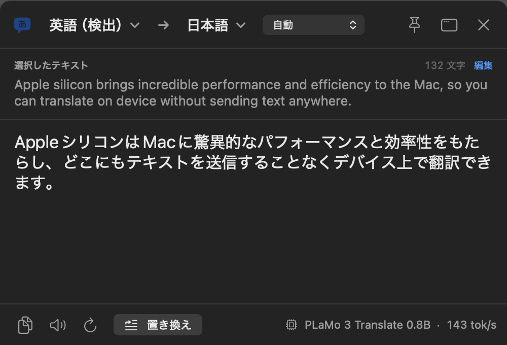
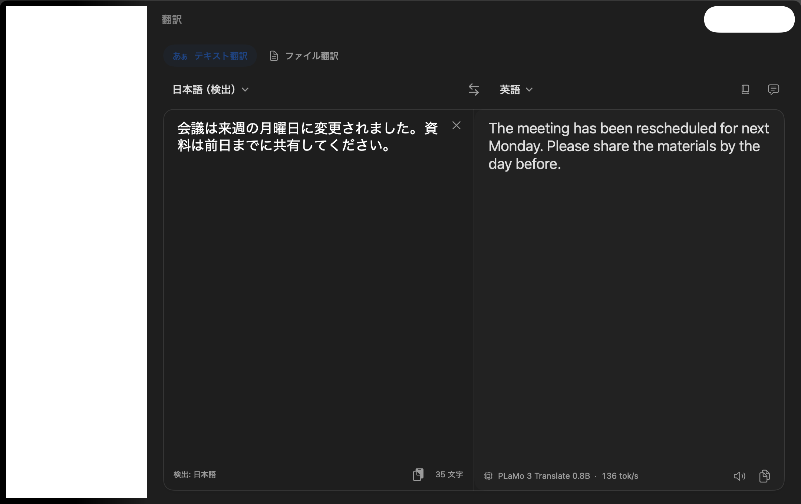
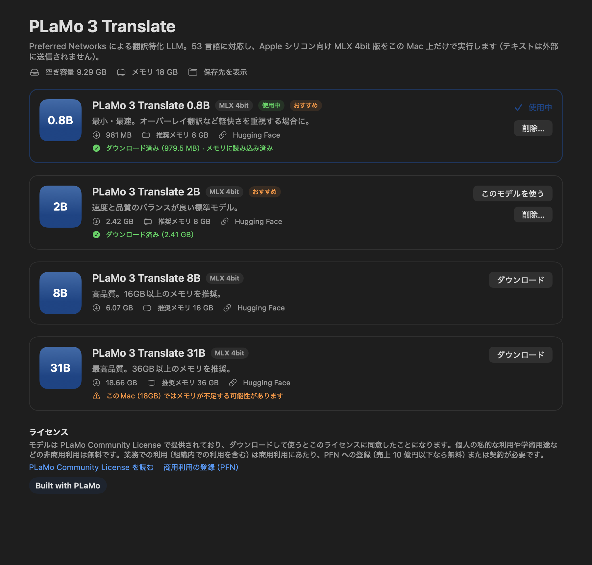
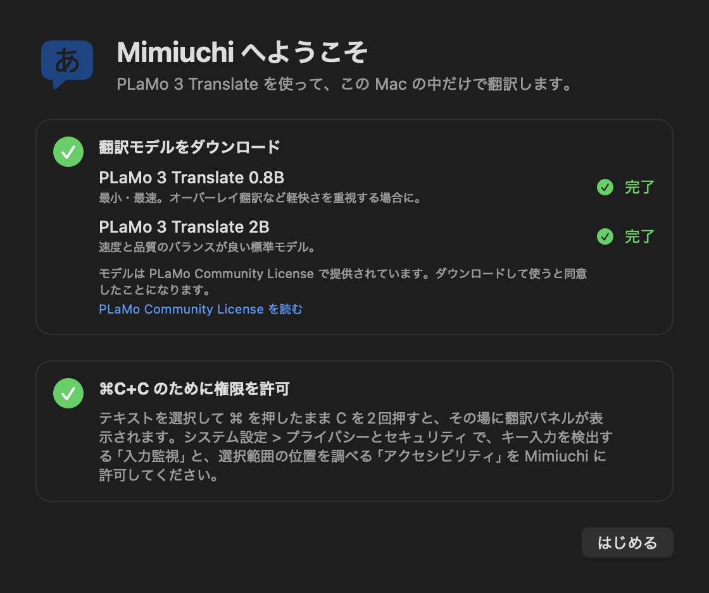
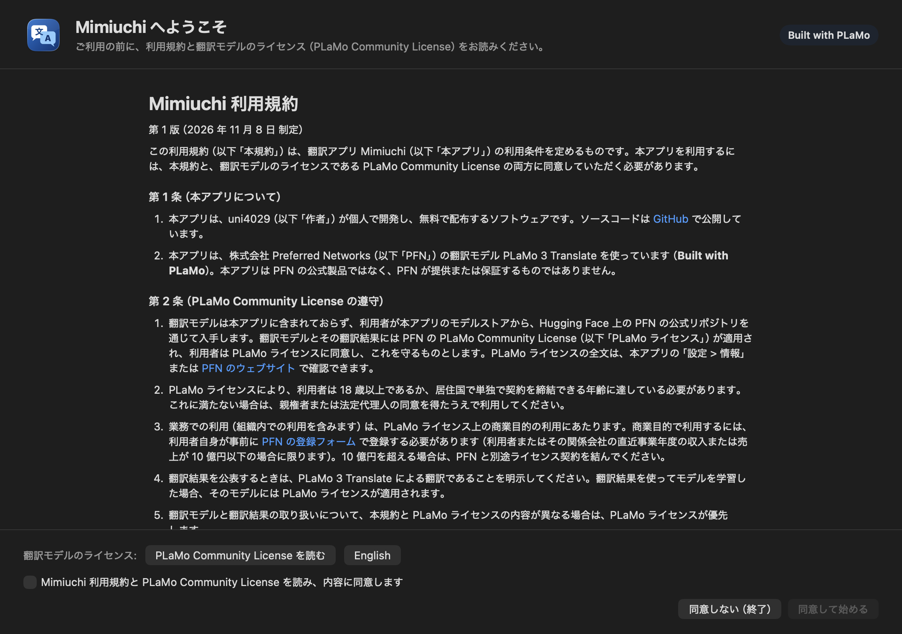
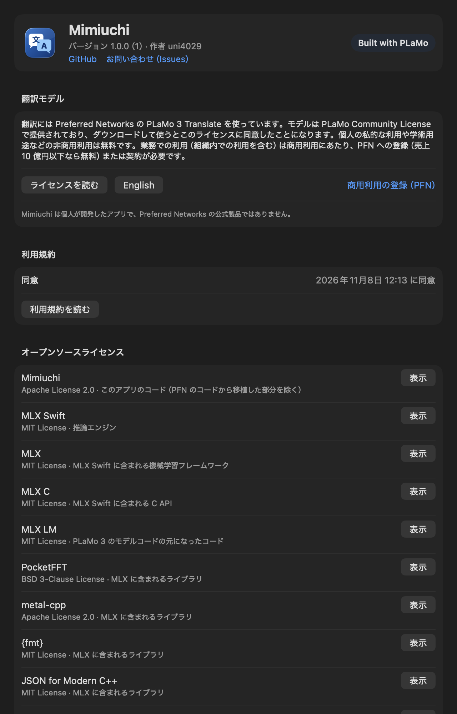

# Mimiuchi（耳打ち）

どのアプリでもテキストを選んで ⌘C+C を押すと、その場にそっと訳を出す macOS ネイティブの翻訳アプリです。
翻訳エンジンは **PLaMo 3 Translate**（Preferred Networks）。モデルは Apple シリコン向け MLX 4bit 版を **Mac 上だけで実行** します（テキストは外部に送信されません）。

**Built with PLaMo** — Mimiuchi は uni4029 が個人で開発したアプリで、Preferred Networks の公式製品ではありません（[ライセンス](#ライセンス)）。不具合の報告やお問い合わせは [Issues](https://github.com/uni4029/Mimiuchi/issues) へ。

- SwiftUI + AppKit のネイティブアプリ（macOS 26 以降 / Apple シリコン）
- 推論エンジンは自前実装の Swift + [MLX Swift](https://github.com/ml-explore/mlx-swift)（Python 不要）
- PLaMo 3 のモデル構造とトークナイザを Swift に移植し、PFN 公式の mlx-lm ランタイムと出力一致を確認済み

| ⌘C+C オーバーレイ | メインウィンドウ |
| --- | --- |
|  |  |

| モデルストア | 初回セットアップ |
| --- | --- |
|  |  |

| 初回起動（利用規約への同意） | 設定 > 情報（Built with PLaMo・ライセンス） |
| --- | --- |
|  |  |

## 主な機能

| 機能 | 内容 |
| --- | --- |
| テキスト翻訳 | 原文と訳文の 2 ペイン。入力中に自動翻訳、言語の自動検出、⇄ で入れ替え、訳文のコピー・読み上げ |
| **⌘C+C オーバーレイ** | どのアプリでもテキストを選択し、⌘ を押したまま C を 2 回 → 選択位置の近くに翻訳パネルが出て、原文と訳文を確認できる |
| モデルストア | PLaMo 3 Translate 0.8B / 2B / 8B / 31B（MLX 4bit）のダウンロード（進捗・速度・残り時間・キャンセル・SHA-256 検証）、削除、選択 |
| モデル選択 | ツールバー、メニューバー、設定、モデルストアから切り替え |
| 文体 | 日本語訳のとき「です・ます調 / だ・である調」（PLaMo の `form`） |
| 用語集 | 原文に含まれる用語を PLaMo の `glossary` として指定 |
| コンテキスト | 翻訳の前提（文書の種類など）を PLaMo の `context` として指定 |
| ファイル翻訳 | .txt / .md を段落ごとに、直前の訳文を履歴として参照しながら翻訳 |
| 履歴 | 翻訳履歴をこの Mac にのみ保存（オフ可） |
| その他 | メニューバー常駐、サービスメニュー「Mimiuchiで翻訳」、やさしい日本語（`ja-easy`）、ログイン時に起動 |

対応言語は PLaMo 3 Translate の 53 言語 + やさしい日本語です。

## ⌘C+C の仕様

| 操作 | 動作 |
| --- | --- |
| テキストを選択し、⌘ を押したまま C を 2 回 | 選択したテキストの訳文を表示。2 回目の ⌘C で発動（間隔は既定 0.5 秒、設定で 0.25〜0.8 秒） |
| ⌘C を 1 回だけ | 通常のコピーとして動作（何も表示しない） |
| ショートカットの変更 | 修飾キー ⌘/Ctrl/Option/Shift + 英数字キー/スペース（設定 > ショートカット でキーを記録）。⌘C 以外のときはアプリが自動でコピーを実行 |
| ショートカットの無効化 | 設定 > ショートカット でオフにできる |
| 特定のアプリで使わない | 設定 > オフにしたアプリ に追加したアプリでは反応しない |
| オーバーレイパネル | 元のアプリは前面のままで、パネルに原文と訳文を表示。訳文言語・文体の変更、コピー、読み上げ、再翻訳、**置き換え**（訳文を元のテキストに貼り付け）、固定（ピン）、ドラッグ移動、esc / 外側クリックで閉じる、メインウィンドウで開く |
| 原文がすでに訳文の言語 | 「第 2 言語」へ自動で切り替え（既定: 日本語 ⇄ 英語） |

表示先は「設定 > ショートカット」で、オーバーレイ（既定）かメインウィンドウを選べます。オーバーレイはテキストの選択範囲の直下（取得できないアプリではマウス位置付近、または画面中央）に出ます。

ほかのアプリで押した ⌘C+C を検出するために **入力監視**、選択範囲の位置取得と「置き換え」のために **アクセシビリティ** の許可が必要です（初回起動時に案内されます）。macOS では、ほかのアプリでのキー入力を見るにはアクセシビリティだけでは足りず、入力監視が必要です。

## 動作環境

- macOS 26 以降、Apple シリコン
- メモリ: 0.8B / 2B は 8GB 以上、8B は 16GB 以上、31B は 36GB 以上を推奨
- ビルド: Xcode 26 以降（Metal Toolchain が必要: `xcodebuild -downloadComponent MetalToolchain`）、[XcodeGen](https://github.com/yonaskolb/XcodeGen)

## ビルドと起動

```sh
Scripts/build.sh          # Release ビルドして ~/Applications/Mimiuchi.app にインストール
open ~/Applications/Mimiuchi.app
```

Xcode で開く場合は `xcodegen generate` の後に `Mimiuchi.xcodeproj` を開き、スキーム Mimiuchi を実行します。Debug ビルドはバンドル ID が `local.mimiuchi.Mimiuchi.debug` で、権限と設定がインストール版とは別になります（Debug 版で権限を求めても、インストール版の許可は変わりません）。`Scripts/build.sh` は起動中の Mimiuchi を終了してから入れ替え、終わったら起動し直します。

初回起動時の手順:
1. [利用規約](TermsOfUse.md)と PLaMo Community License を読んで同意（同意するまで翻訳・モデルのダウンロード・⌘C+C は使えません）
2. モデルをダウンロード（まずは 0.8B と 2B がおすすめ）
3. システム設定 > プライバシーとセキュリティ の **入力監視** と **アクセシビリティ** で Mimiuchi を許可（入力監視は「終了して再度開く」で再起動）

> **署名について**: macOS は入力監視・アクセシビリティの許可をアプリのコード署名に結び付けます。Xcode 既定の ad-hoc 署名はビルドのたびに変わるため、再ビルドするとシステム設定のスイッチはオンのまま、新しいアプリには許可が効かなくなります。`Scripts/build.sh` は初回に **この Mac 専用の自己署名証明書**（`~/Library/Application Support/Mimiuchi-Signing/` の専用キーチェーン）を作り、毎回同じ証明書で署名するので、**許可は一度だけで再ビルド後も有効** です。署名が変わったときは古い許可を自動でリセットします（`MIMIUCHI_ADHOC_SIGN=1` で ad-hoc 署名のままにもできます）。証明書は署名専用で、システムには信頼させていません。不要になったらフォルダごと削除してください。

### ⌘C+C が反応しないとき

| 症状 | 対処 |
| --- | --- |
| アプリのサイドバー下部やメニューに「⌘C+C を使うには許可が必要」「⚠︎ ⌘C+C の権限を許可…」と出る | 設定 > ショートカット > 権限 で、未許可の項目（入力監視 / アクセシビリティ）を許可してください |
| システム設定で Mimiuchi がオンなのに「未許可」のまま | 以前のビルドへの許可が残っています。アプリの「許可する…」を押すと古い許可を取り除いて改めて許可を求めるので、もう一度オンにしてください |
| 入力監視をオンにしたのに反応しない | 入力監視は Mimiuchi の再起動後に有効になります。メニューバーやサイドバーに「再起動して ⌘C+C を有効にする」が出たら押してください |
| Mimiuchi のウィンドウ内で ⌘C+C しても何も起きない | 仕様です（ほかのアプリで選択したテキストが対象）。Mimiuchi 内ではそのまま入力欄に貼り付けてください |
| パスワード入力欄やセキュア入力中のターミナル | macOS がキー入力の監視を止めるため反応しません |
| 2 回押しが認識されにくい | 設定 > ショートカット で「2回押しの間隔」を長くしてください |

モデルは `~/Library/Application Support/Mimiuchi/Models/` に保存されます。

## 検証結果（M3 Pro / 18GB）

| 項目 | 結果 |
| --- | --- |
| トークナイザ | PFN の Python 実装と、ゴールデン 21 件・プロンプト 7 件・ランダム 3,000 件で **100% 一致** |
| 0.8B 出力一致 | 公式 mlx-lm ランタイムの greedy 出力と **37/37 件一致** |
| 2B 出力一致 | **36/37 件一致**（残り 1 件は "related work" と "related research" の僅差で、PFN 実装と完全に同じ演算順序でも同様に分かれるため、MLX のカーネル差によるもの） |
| 速度 0.8B | 生成 約 150 tok/s、プロンプト処理 約 2,300 tok/s、読み込み 約 0.8 秒 |
| 速度 2B | 生成 約 55〜59 tok/s、プロンプト処理 約 600 tok/s |
| アプリ内 E2E | メイン翻訳・⌘C+C トリガーからのオーバーレイ翻訳・モデル削除→再ダウンロード→使用 を 0.8B / 2B で確認 |
| ⌘C+C 判定 | 2 回押し・間隔超過・オートリピート・他キー割り込み・修飾キー違い・3 回押し・カスタムキーの単体テスト 11 件 |
| ⌘C+C 実キー E2E | `Tools/e2e-cmdcc.sh`: Mimiuchi を通常起動（自身の入力監視・アクセシビリティ許可で動作）し、テスト用ウィンドウで日本語の文を選択して、システムのキーイベント（HID レベル。物理キーボードと同じ経路）で ⌘C を 2 回 → 選択範囲の直下にオーバーレイが出て、原文と訳文（0.8B、127 tok/s）を表示。⌘C 1 回では表示されないことも確認 |
| 権限の持続 | ローカル証明書で署名したビルドを作り直しても（cdhash が変わっても）入力監視・アクセシビリティの許可が有効なままであることを確認 |

高速化について: PLaMo 3 Translate の MLX 版は量子化スケールが FP16（活性は BF16）のため、そのままでは MLX Swift の JIT カーネルで FP32 への型昇格が起き、Python 版の 1/3 程度の速度になります。読み込み時にスケールを BF16 に揃え、MLX の fused RMSNorm を使うことで公式ランタイム以上の速度にしています（出力一致は上表のとおり）。`PLAMO_REFERENCE=1` で PFN 実装と同一の演算順序に切り替えられます。

## 構成

```
Mimiuchi/                アプリ本体（SwiftUI + AppKit）
  App/                   起動、AppModel、メニューバー、サービス、スナップショット診断
  Services/              ⌘C+C 監視・選択テキスト取得・オーバーレイ・翻訳セッション・モデル管理
  Views/                 翻訳画面、オーバーレイ、モデルストア、設定、情報（ライセンス）、履歴、用語集、オンボーディング
  Models/                設定、履歴、用語集
Packages/PlamoKit/       推論エンジン
  PlamoTokenizer         PLaMo トークナイザ（Aho-Corasick + Unigram）と PFML3 プロンプト
  PlamoKit               PLaMo 3 モデル（MLX）、翻訳アクター、言語一覧、モデルカタログ/ストア
  plamo-cli              開発用 CLI
Packages/MimiuchiCore/   ⌘C+C 判定などの UI 非依存ロジック（単体テスト付き）
TermsOfUse.md            利用規約（初回起動時に表示し、同意を求める。本文を変えると全員に再同意を求める）
Licenses/                同梱するライセンス文（PLaMo Community License と OSS。アプリの 設定 > 情報 にも表示）
Scripts/                 build.sh / test.sh
Tools/                   参照データ生成（PFN 公式ランタイム）、アイコン生成、⌘C+C 自動テスト用ハーネス
```

## 開発者向け

```sh
Scripts/test.sh                         # トークナイザと ⌘C+C 判定の単体テスト
# CLI（Xcode でビルド: Packages/PlamoKit のスキーム plamo-cli）
plamo-cli list | download 0.8b | delete 0.8b
plamo-cli translate 0.8b en "会議は来週の月曜日に変更されました。"
plamo-cli golden 2b Tools/reference/golden-2b.json   # 公式 mlx-lm の出力との一致を確認（参照データの再生成は Tools/reference/README.md）
plamo-cli bench 2b
# アプリの自己診断（自分のウィンドウを PNG に描画）
MIMIUCHI_SNAPSHOT_DIR=/tmp/snap ~/Applications/Mimiuchi.app/Contents/MacOS/Mimiuchi
# 実キーボードでの ⌘C+C 自動テスト（画面ロック解除中に実行）
#   Mimiuchi を通常起動（自身の入力監視・アクセシビリティ許可で動作）し、ハーネスが自分のウィンドウでテキストを選択して
#   ⌘C を2回押し、オーバーレイ表示と訳文を確認、さらに ⌘C 1回では表示されないことを確認する
#   （前面でない場合はキーを一切押さずに中止）。MIMIUCHI_E2E_LAUNCH=child でターミナルの権限を引き継いで起動
Tools/e2e-cmdcc.sh
# ローカル署名の証明書を作成/確認（build.sh が自動で呼びます）
Scripts/setup-signing.sh
```

## ライセンス

**Built with PLaMo** — Mimiuchi は Preferred Networks の PLaMo 3 Translate を使っています。Mimiuchi は個人が開発したアプリで、Preferred Networks の公式製品ではありません。

- **翻訳モデル**: PLaMo 3 Translate は [PLaMo Community License](https://plamo.preferredai.jp/info/plamo-community-license-ja) で提供されています。モデルはアプリに含まれず、モデルストアが Hugging Face の PFN 公式リポジトリから直接ダウンロードします。ダウンロードして使うとこのライセンスに同意したことになります。個人の私的な利用や学術用途などの非商用利用は無料です。業務での利用（組織内での利用を含む）は商用利用にあたり、[PFN への登録](https://forms.gle/mTL8tBLrMYXKNZD56)（売上 10 億円以下なら無料）または別途契約が必要です。
- **PlamoKit**: PFN のトークナイザ（`tokenization_plamo.py`）、プロンプト形式（`chat_template.jinja`）、モデルコード（`modeling_plamo_mlx.py`）を Swift に移植した部分は、PLaMo のモデルコードの派生物として PLaMo Community License に従います（© Preferred Networks, Inc.）。`modeling_plamo_mlx.py` は mlx-lm（MIT License, © 2023 Apple Inc.）を元にしています。詳細は [`Packages/PlamoKit/NOTICE.md`](Packages/PlamoKit/NOTICE.md)。
- **Mimiuchi のコード**: [Apache License 2.0](LICENSE)。ただし PlamoKit の PFN 由来部分、PLaMo 3 Translate で生成した参照・テストデータ、`Licenses/` のライセンス文は除きます（[`NOTICE`](NOTICE)）。
- **オープンソース**: MLX Swift / MLX / MLX C / MLX LM（MIT）、PocketFFT（BSD 3-Clause）、metal-cpp（Apache 2.0）、{fmt}（MIT）、JSON for Modern C++（MIT）、Swift Numerics（Apache 2.0）。
- **利用規約**: 初回起動時に [利用規約](TermsOfUse.md) を表示し、同意するまで翻訳・モデルのダウンロード・⌘C+C を使えないようにしています。本文（先頭のコメントを除く）を 1 文字でも変えると、次の起動時に全員へ改めて同意を求めます。
- ライセンス文は [`Licenses/`](Licenses/README.md) にあり、アプリにも同梱しています（設定 > 情報、メニューバーの「Mimiuchi について」）。
